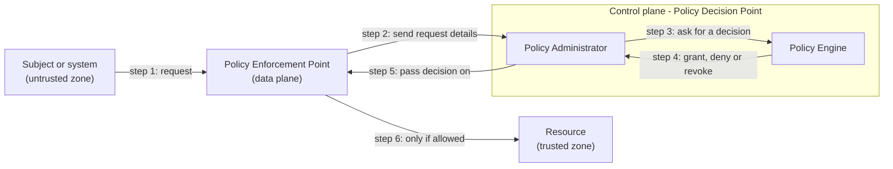

**CompTIA Security+ SY0-701 – Exam Objective 1.2**
**Source videos:** Professor Messer – The CIA Triad; Non-repudiation; Authentication, Authorization, and Accounting

## What This Covers

Three properties every security control is ultimately protecting:

| Property | What it means |
|---|---|
| Confidentiality | Keeping information away from anyone who shouldn't see it |
| Integrity | Making sure data hasn't been changed, by accident or on purpose |
| Availability | Making sure systems and data stay accessible when needed |

Common ways each one gets achieved:
- **Confidentiality** – encryption, access controls, extra authentication factors
- **Integrity** – hashing, digital signatures, certificates
- **Availability** – redundancy/fault tolerance, patching, monitoring

### Non-repudiation

Non-repudiation means someone can't credibly deny they sent something — the digital version of a signature on a contract. It's built from two things working together:
- **Proof of integrity** – a hash confirms the data wasn't changed
- **Proof of origin** – a digital signature (a hash encrypted with a private key) confirms who sent it

Combine both and anyone holding the sender's public key — not just the two people involved — can check both at once: that the data is untouched, and who it came from.

### Authentication, Authorization, and Accounting (AAA)

Four steps happen every time someone logs in:

| Step | Question it answers | Example |
|---|---|---|
| Identification | Who are you claiming to be? | Typing a username |
| Authentication | Can you prove it? | Password, plus extra factors like an MFA code |
| Authorization | What are you allowed to do? | Finance group members can open the Finance share |
| Accounting | What did you do? | Logs of login/logout times and data sent or received |

Only the last three are in the AAA name. Identification is the claim; authentication is the proof.

**Central AAA server.** Network devices like a VPN concentrator or firewall don't keep usernames and passwords themselves. They pass the login to a central AAA server, which checks the credentials and replies approve or deny. The device then lets the user in (or not). This keeps all credential checking in one place.

**Authenticating devices.** A laptop can't type a password, and you don't want passwords stored on devices out in the field. Instead, a Certificate Authority (CA) issues the device a certificate and digitally signs it. At login, the certificate is checked against the CA's signature. If it's valid, the device is confirmed as a company device. The CA's own certificate is signed by a root CA above it.

**Authorization models.** Giving every user their own permissions on every resource doesn't scale. An authorization model adds a layer in the middle — usually roles, groups or attributes — so you grant access to the group once, then just add or remove people. Adding a new starter to the Finance group gives them everything Finance needs in one step. 

### Gap analysis

A gap analysis compares where you are now with where you want to be, then plans how to close the difference. Real ones take weeks, months or even years and involve a lot of people, so it's a project rather than a quick scan.

**The process**

1. **Pick a baseline** – the target you measure against. It can be a published one or one you write yourself. Some are made for specific kinds of organisation.
2. **Assess people** – their experience, their training, and whether they know your security policies.
3. **Assess processes and systems** – do the systems you actually run match your written policies? Compare them with the baseline, list the weaknesses, and note how you could compensate for them.
4. **Break broad areas into small pieces** – "access control", for example, splits into registering and removing users, granting access, managing privileged access, and reviewing access rights. Each piece is checked separately.
5. **Write the report** – where you are, where you want to be, and the path between. The path usually takes time and money, may need new equipment, and goes through change control.
6. **Prioritise** – a summary table colours each location or requirement green (close to the baseline), yellow (halfway) or red (a lot of work needed). Start with red, then yellow, then green.

Baselines named in the video:

| Baseline | From | About |
|---|---|---|
| NIST SP 800-171 Rev 2 | National Institute of Standards and Technology | Protecting controlled unclassified information in non-federal systems and organisations |
| ISO/IEC 27001 | ISO and IEC | Information security management systems |

**Quick recall**
- Gap analysis = current state vs wanted state, measured against a baseline
- Pick the baseline first (NIST SP 800-171 Rev 2, ISO/IEC 27001, or your own)
- It covers people, processes and systems
- The report includes the plan to close each gap: time, money, equipment, change control
- Red/yellow/green table: fix red first

### Zero trust

Zero trust means nothing is trusted just because it's inside the network. Every user, device and process has to prove itself each time it wants a resource. In practice that means things like multi-factor authentication, encrypting data (stored and moving), tighter permissions, extra firewalls and more security policies.

**Two planes.** Each security device — physical, virtual or cloud — can be split into two parts:

| Plane | What it does | Examples |
|---|---|---|
| Data plane | Does the actual work on traffic | Forwarding, NAT and routing on a switch, router or firewall |
| Control plane | Manages and configures the data plane | Firewall rules, routing tables, NAT settings, policies |

**Control plane ideas**
- **Adaptive identity** – look at the context as well as the password: where the request comes from (say, US-based data requested from a Chinese IP address), the person's relationship to the organisation (employee or contractor, full or part time), physical location, connection type and IP address. If something looks off, ask for stronger authentication automatically.
- **Threat scope reduction** – limit the ways into the network (for example, only from inside the building or through the VPN), so there's less to attack.
- **Policy-driven access control** – combine all that information and decide which authentication to require.

**Security zones** group traffic by where it comes from and where it's going: untrusted or trusted, internal or external, or finer groups such as VPN and departments. Rules then say which zone can reach which — for example, deny anything from an untrusted zone to a trusted one. Zones also allow **implicit trust**: an office user in a trusted zone reaching a database in the internal zone can be trusted for that part of the path.

**The decision parts**

| Part | Plane | Job |
|---|---|---|
| Policy Enforcement Point (PEP) | Data | The gatekeeper — all traffic passes through it. It gathers information and allows or blocks, but doesn't decide |
| Policy Engine | Control | Compares the request with predefined policies and decides: grant, deny or revoke |
| Policy Administrator | Control | Passes the decision to the PEP and creates any access tokens or credentials needed |

The Policy Engine and Policy Administrator together are the **Policy Decision Point (PDP)**.

Read it left to right: the request arrives at the PEP, the control plane decides, and the PEP only lets the traffic through if the answer is yes.

**Quick recall**
- Zero trust = never trust, always verify — every user, device and process, every time
- Data plane moves the traffic; control plane manages and decides
- PEP enforces (data plane); the Policy Engine decides and the Policy Administrator passes the decision on and issues tokens (control plane)
- Adaptive identity = context-based authentication; threat scope reduction = fewer ways in; policy-driven access control = the rules that tie it together
- Zones: untrusted to trusted is denied by default; implicit trust covers a path between trusted and internal zones

### Physical security

IT security covers the physical world too. Common controls:

| Control | What it does | Key points |
|---|---|---|
| Bollards and barricades | Keep vehicles out of an area while people can still walk through | Channel people to a set entrance; bright colours signal a high-security area; can be concrete or other barriers (e.g. water with a bridge) |
| Access control vestibule | A small room between outside and inside with interlocked doors, so they can't all be open at once | Controls how many people pass at a time and lets you check ID; common in data centres. Older name: mantrap |
| Fences | Block access along a boundary | Transparent (see through) or opaque; must be robust; taller or topped with razor wire for higher security |
| Video surveillance (CCTV) | Cameras sending video to one central store | Motion detection, object detection (faces, licence plates), alerts |
| Security guards | Check that people entering are staff or approved guests | Often work in pairs (two-person integrity/control) so one guard can't bypass policy alone |
| Access badges | Visible photo ID | Shows name, photo and details; linked to electronic door locks; every badge-in is logged centrally |
| Lighting | Makes sneaking in harder | More light = more security; coverage and angles matter, especially for facial recognition; pair with cameras |

**Sensors**

| Sensor | How it works | Notes |
|---|---|---|
| Infrared | Detects infrared radiation, so it works in light or dark | Used in cameras and motion detectors; good for smaller areas |
| Pressure | Notices a change in force when someone moves across it | Alerts when something crosses the area |
| Microwave | Detects movement using microwaves | Covers much larger areas, so can be more efficient than infrared |
| Ultrasonic | Sends out sound waves and looks for reflections | Detects motion, and collisions (e.g. parking lots, loading zones) |

**Which control type?** (links back to 1.1) Many physical controls fit more than one type, so go by what the question emphasises.
- Preventive: bollards, fences, access control vestibules, badge-locked doors
- Deterrent: visible cameras, lighting, warning signs, razor wire
- Detective: CCTV recordings, motion/pressure/microwave/ultrasonic sensors, badge logs
- Guards can be all three

### Deception and disruption

As well as keeping attackers out, you can mislead and slow them — and learn from what they try. Most of the "attackers" that hit these traps are automated tools, so you see which tools and targets are in use. Attackers get better at spotting fakes, so defenders keep making theirs more realistic.

| Term | What it is | Example |
|---|---|---|
| Honeypot | A fake system that attracts attackers and keeps them busy while you watch their methods. Not part of production | A virtual server that looks real (commercial and open-source software exists to build them) |
| Honeynet | Several honeypots combined into a bigger, more believable fake network | Fake workstations, servers, routers and firewalls together |
| Honeyfile | A decoy file that looks valuable. Nobody legitimate should open it, so any access is a warning sign | A fake `passwords.txt` that sends an alert when opened |
| Honeytoken | Fake, traceable data. If it turns up somewhere else, you know where it leaked from | Fake API credentials on a public share; made-up email addresses you watch for; fake database records, cookies or tracking pixels |

## Lab Environment

Reuses the existing home lab from [cybersecurity-home-lab](https://github.com/EnumaElish9999/cybersecurity-home-lab):

- **Kali** – 10.0.2.15 (NAT) / 10.10.10.1 (internal, also acting as gateway)
- **Windows 10** – 10.10.10.10 (internal network, standalone, not domain-joined)
- **AD-Server** – 10.10.10.2, domain controller for `cyberlab.local`
- **Windows 11 client** – domain-joined to `cyberlab.local`
- Accounts from Lab 14: an admin account, a standard user, a service account

AD-Server now runs the whole domain, so snapshot it before Exercises 1, 6 and 8 — same habit as snapshotting Windows 10 in 1.1.

## Practical Exercise

Exercises 1–6 give two examples for each CIA property. Exercises 7 and 8 cover gap analysis and deception. The other topics are notes only.

### 1. Confidentiality – Access control (AD permissions)

**Goal:** Prove only the right account can reach a restricted resource.

- On AD-Server, create a folder (e.g. `C:\Shares\Finance`) and share it
- Set NTFS/share permissions so only the admin account can access it — remove "Authenticated Users" or "Everyone" if either is there by default, and don't grant the standard user
- From the Windows 11 client, log in as the standard user and try `\\AD-Server\Finance` — should be denied
- Log in as the admin account and confirm access works
- **Capture:** the permission settings, plus both access attempts

**Extension – group-based access (the authorization part of AAA):**

- In Active Directory Users and Computers on AD-Server, create a security group (e.g. `Finance-Users`)
- Give `Finance-Users` access to the Finance folder (NTFS and share permissions)
- Add the standard user to the group, then sign out and back in on the Windows 11 client (group changes only apply at the next sign-in) and open `\\AD-Server\Finance` — it should now work
- Remove the user from the group, sign out and in again, and confirm access is denied again
- **Capture:** the group membership before and after, plus both access results

### 2. Confidentiality – Encryption

**Goal:** Show encrypted data is unreadable without the key.

- On Kali, create a short test file
- Encrypt it: `openssl enc -aes-256-cbc -pbkdf2 -in secret.txt -out secret.enc`
- Try to view `secret.enc` directly — it should look like garbage
- Decrypt it back: `openssl enc -d -aes-256-cbc -pbkdf2 -in secret.enc -out secret_decrypted.txt` and confirm it matches the original
- **Capture:** the unreadable encrypted file, plus the successful decryption

### 3. Integrity – Hashing

**Goal:** Show that even a tiny change breaks the match.

- On Kali, create a test file and hash it: `sha256sum testfile.txt`
- Change one character in the file
- Hash it again — the result should be completely different
- **Capture:** both hashes side by side

### 4. Integrity & Non-repudiation – Digital signature

**Goal:** Prove data wasn't altered, and confirm who signed it.

- Generate a key pair: `openssl genrsa -out private.pem 2048` then `openssl rsa -in private.pem -pubout -out public.pem`
- Sign the file: `openssl dgst -sha256 -sign private.pem -out testfile.sig testfile.txt`
- Verify it: `openssl dgst -sha256 -verify public.pem -signature testfile.sig testfile.txt` — should say Verified OK
- Change the file slightly, verify again — it should now fail
- **Capture:** the successful and failed verification results

**Why this covers non-repudiation too:** signing with your private key and verifying with the public key already gives you both halves of it — the hash catches tampering (integrity), and only your private key could have produced a signature that verifies against your public key (proof of origin). A separate exercise would just repeat the same commands. Worth adding to your note: anyone with your public key, not just you, could run that same verify command and get the same result — that's the part that makes it non-repudiation rather than a plain integrity check.

### 5. Availability – Patch status

**Goal:** Document patch status as part of keeping systems available.

- On the Windows 11 client, go to Settings > Windows Update and check for updates
- Note the current status — up to date, or pending updates — and the last check date
- **Capture:** a screenshot of the Windows Update status page

### 6. Availability – Domain controller single point of failure

**Goal:** Show why a single point of failure matters.

- With Windows 11 already logged in, confirm `\\AD-Server\Finance` (from Exercise 1) is reachable
- On AD-Server, temporarily disable the network adapter
- From Windows 11, try `\\AD-Server\Finance` again — it should now fail or time out
- Re-enable AD-Server's network adapter and confirm access works again
- **Capture:** before/after screenshots, plus a short note on why relying on one DC is risky

### 7. Gap analysis – Mini gap analysis of the lab

**Goal:** Practise the gap analysis process on a small scale, with your own lab as the "organisation".

- Pick a baseline: 6–8 requirements from a published one such as NIST SP 800-171 Rev 2 (the access control section is a good place to start), or write a short list of your own
- Check the lab (AD-Server, Windows 10, Windows 11, Kali) against each requirement and write down what you really find — reuse evidence from earlier exercises where it fits (permissions from Exercise 1, audit events from 1.1 Exercise 3, patch status from Exercise 5)
- Rate each one: green (met), yellow (partly met) or red (not met)
- For every yellow or red, write the fix and what it would take (time, cost, and what to back up or test first)
- Put it in a table — Requirement, Current state, Rating, Fix — with the red rows first
- **Capture:** the finished table, saved as `gap-analysis.md` in this folder

Red rows are fine — finding gaps is the point.

### 8. Deception – Honeyfile and decoy account

**Goal:** Set traps that show you when someone touches something they shouldn't.

**Part A – Honeyfile (on Windows 10)**

- In an elevated Command Prompt, turn on file auditing: `auditpol /set /subcategory:"File System" /success:enable`
- Create `C:\Honey\passwords.txt` with obviously fake contents — never real passwords
- Right-click the file > Properties > Security > Advanced > Auditing > Add. Set the principal to Everyone, the type to Success, and tick Read
- Open the file in Notepad, as if you were the intruder
- In Event Viewer > Windows Logs > Security, find Event ID 4663 for `passwords.txt` (use Find, since 4663 is noisy) and note the account and time
- **Capture:** the auditing entry and the event

**Part B – Decoy account (on AD-Server)**

- Snapshot AD-Server first
- In Active Directory Users and Computers, create a believable decoy user such as `svc-backup-old` with a long random password and no extra group memberships. It's bait — nobody should ever use it
- Make sure Kerberos auditing covers success and failure (you fixed this in Lab 15, but check failure is included too): `auditpol /set /subcategory:"Kerberos Authentication Service" /success:enable /failure:enable`
- On the Windows 11 client, try to sign in as the decoy account with a wrong password on purpose
- On AD-Server, look in Event Viewer > Windows Logs > Security for Event ID 4771 (or 4768) naming the decoy account
- **Capture:** the event, plus one line on why any activity on this account is suspicious

**Why this one is worth doing:** it turns deception into detection — the same idea as the audit logging in 1.1, but aimed at a trap. Later, once you have a SIEM, forwarding these events to it would let the traps raise alerts automatically.

## Results

_Fill in after each exercise: what you did, what you saw, any issues you hit._

## Key Takeaways

_Fill in after finishing: 2–3 sentences on what this taught you._
